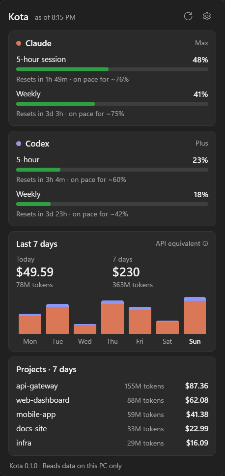

<div align="center">


# Kota

**See your Claude Code and Codex limits in the Windows taskbar, before you hit them.**

A tiny, native Windows tray app. No Electron, no WSL, no Python, no account.

[](https://github.com/BerkanAtik/kota/actions/workflows/ci.yml)
[](https://github.com/BerkanAtik/kota/releases/latest)
[](LICENSE)

English · [Türkçe](README.tr.md)



</div>

## Why

You are deep in a task and Claude Code stops: *"5-hour limit reached"*. Kota keeps the number in the corner of
your screen and warns you early, so you can plan around it.

*Kota* is Turkish for "quota".

## Features

- **Live percentage in the tray icon.** The icon turns green, amber or red as you use your limit.
- **Claude and Codex together.** Shows the 5-hour session and weekly limits for Claude (Pro/Max), plus your Codex plan limits.
- **"Full in ~25 min at this pace".** Kota projects whether you will run out before the window resets.
- **Notifications at 80% and 95%.** You get one per limit window, so they don't repeat.
- **Where your tokens go.** Shows the last 7 days by day and by project, with what that usage would cost at API prices.
- **Fast and light.** The first scan of 1.7 GB of logs takes about 3 seconds. After that, Kota only reads new lines. The app is a single `.exe`, 300 KB or 66 MB depending on the download.
- **Native look.** Follows Windows light and dark mode. Available in English and Turkish.

## Install

1. Download from the [latest release](https://github.com/BerkanAtik/kota/releases/latest):
   - **`Kota-win-x64.exe`** (66 MB): runs anywhere, no install needed.
   - **`Kota-win-x64-small.exe`** (0.3 MB): needs the [.NET 10 Desktop Runtime](https://dotnet.microsoft.com/download/dotnet/10.0).
2. Run it. Windows SmartScreen may warn because the app is new and unsigned: choose **More info → Run anyway**.
3. Kota appears in the tray. Windows hides new tray icons by default, so drag it from the **^** overflow menu onto the taskbar.
4. Right-click the icon and turn on **Start with Windows**.

Left-click the icon to open the panel. Running `Kota.exe` again also opens it.

## How it works

| Source | What Kota reads | Network |
|---|---|---|
| Claude limits | The sign-in Claude Code stores in `~/.claude/.credentials.json`, used to call the same usage endpoint Claude Code's `/usage` screen uses | `api.anthropic.com` only, every 3 minutes |
| Codex limits | The latest `rate_limits` entry Codex writes into `~/.codex/sessions/**.jsonl` | none |
| Token history | Claude Code transcripts in `~/.claude/projects` and Codex session logs | none |

**Privacy.** Kota has no telemetry and no server. Your token is sent only to `api.anthropic.com`, the same place
Claude Code sends it. Kota never refreshes or changes your credentials. Everything it saves (settings and a
small scan cache) stays in `%LOCALAPPDATA%\Kota`.

`CLAUDE_CONFIG_DIR` and `CODEX_HOME` are respected if you moved those folders.

## FAQ

**The Claude card says "session expired".** Claude Code refreshes its sign-in when it runs. Open Claude Code once and Kota picks it up within a minute.

**Codex shows an old number.** Codex only records your limit while you use it. Kota shows when the number was recorded, and resets it to 0% once the window has passed.

**Is the cost real?** No. It is what the same tokens would cost on the Anthropic API at list prices. It shows how much value you get from a subscription. Codex usage shows tokens only.

**Can it break?** The Claude usage endpoint is the one Claude Code uses, but it is not publicly documented. If it changes, Kota shows an error on the Claude card and everything else keeps working. Please [open an issue](https://github.com/BerkanAtik/kota/issues).

## Build from source

```powershell
git clone https://github.com/BerkanAtik/kota
cd kota
dotnet test
dotnet run --project src/Kota.App -- --show          # real data
dotnet run --project src/Kota.App -- --show --demo   # sample data, for screenshots
```

Requires the .NET 10 SDK on Windows 10 or 11. The parsing and math are in `src/Kota.Core` and covered by tests. The WPF tray app is in `src/Kota.App`.

## Roadmap

- [ ] `winget install Kota`
- [ ] Per-provider tray icons
- [ ] Gemini CLI and GitHub Copilot limits
- [ ] Configurable thresholds and refresh interval in the UI

Ideas and pull requests are welcome.

## License

[MIT](LICENSE). Kota is an independent project and is not affiliated with Anthropic or OpenAI.
