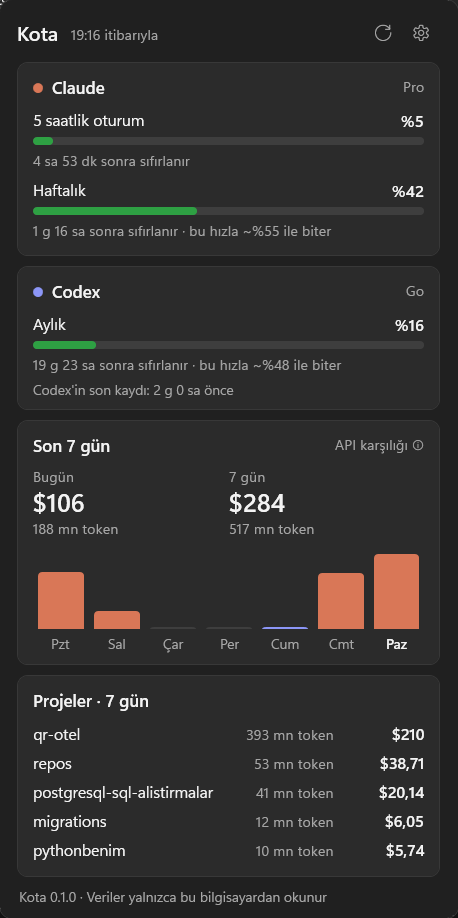

<div align="center">


# Kota

**Claude Code ve Codex limitlerini, dolmadan önce Windows görev çubuğunda gör.**

Küçük, yerel bir Windows uygulaması. Electron, WSL, Python ya da hesap gerektirmez.

[English](README.md) · Türkçe



</div>

## Neden?

Bir işin tam ortasındasın ve Claude Code duruyor: *"5 saatlik limit doldu"*. Kota bu sayıyı ekranının
köşesinde tutar ve seni önceden uyarır. Böylece işini buna göre planlayabilirsin.

## Özellikler

- **Simgede canlı yüzde.** Limitin doldukça simge yeşilden sarıya, sonra kırmızıya döner.
- **Claude ve Codex birlikte.** Claude (Pro/Max) için 5 saatlik oturum ve haftalık limitleri, Codex için plan limitini gösterir.
- **"Bu hızla ~25 dk içinde dolar".** Limitin sıfırlanmadan önce dolup dolmayacağını tahmin eder.
- **%80 ve %95'te bildirim.** Her limit döneminde yalnızca bir kez gelir, tekrar etmez.
- **Token'ların nereye gidiyor?** Son 7 günü gün ve proje bazında gösterir. Bu kullanımın API fiyatlarıyla ne tutacağını da hesaplar.
- **Hızlı ve hafif.** 1,7 GB kaydın ilk taraması yaklaşık 3 saniye sürer, sonra yalnızca yeni satırlar okunur. Tek bir `.exe` dosyasıdır: indirdiğin sürüme göre 300 KB ya da 66 MB.
- **Windows'a uyumlu görünüm.** Açık ve koyu temaya uyar. Türkçe ve İngilizce desteklenir.

## Kurulum

1. [Son sürümden](https://github.com/BerkanAtik/kota/releases/latest) indir:
   - **`Kota-win-x64.exe`** (66 MB): her yerde çalışır, kurulum gerektirmez.
   - **`Kota-win-x64-small.exe`** (0,3 MB): [.NET 10 Desktop Runtime](https://dotnet.microsoft.com/download/dotnet/10.0) gerektirir.
2. Çalıştır. Uygulama yeni ve imzasız olduğu için Windows SmartScreen uyarı verebilir. **Ek bilgi → Yine de çalıştır** seç.
3. Kota sistem tepsisinde görünür. Windows yeni simgeleri varsayılan olarak gizler. Simgeyi **^** menüsünden görev çubuğuna sürükle.
4. Simgeye sağ tıklayıp **Windows ile başlat** seçeneğini aç.

Paneli açmak için simgeye sol tıkla. `Kota.exe`'yi tekrar çalıştırmak da paneli açar.

## Nasıl çalışır?

| Kaynak | Kota neyi okur? | Ağ |
|---|---|---|
| Claude limitleri | Claude Code'un `~/.claude/.credentials.json` dosyasına kaydettiği giriş bilgisi. Bununla Claude Code'un `/usage` ekranının kullandığı adres sorgulanır | Yalnızca `api.anthropic.com`, 3 dakikada bir |
| Codex limitleri | Codex'in `~/.codex/sessions/**.jsonl` dosyalarına yazdığı son `rate_limits` kaydı | yok |
| Token geçmişi | `~/.claude/projects` içindeki Claude Code kayıtları ve Codex oturum kayıtları | yok |

**Gizlilik.** Kota'da telemetri ya da sunucu yok. Oturum anahtarın yalnızca `api.anthropic.com`'a gider, yani
Claude Code'un zaten gönderdiği yere. Kota giriş bilgilerini asla yenilemez ya da değiştirmez. Kaydettiği her
şey (ayarlar ve küçük bir tarama önbelleği) `%LOCALAPPDATA%\Kota` klasöründe kalır.

Bu klasörleri taşıdıysan `CLAUDE_CONFIG_DIR` ve `CODEX_HOME` ortam değişkenleri dikkate alınır.

## Sık sorulanlar

**Claude kartında "oturumun süresi dolmuş" yazıyor.** Claude Code çalıştığında girişini yeniler. Claude Code'u bir kez aç, Kota bir dakika içinde algılar.

**Codex eski bir değer gösteriyor.** Codex limitini yalnızca kullanıldığı sırada kaydeder. Kota bu değerin ne zaman kaydedildiğini gösterir. Limit dönemi geçince değeri %0'a çeker.

**Maliyet gerçek mi?** Hayır. Aynı token'ların Anthropic API liste fiyatlarıyla ne tutacağını gösterir. Aboneliğinden ne kadar değer aldığını görmeni sağlar. Codex için yalnızca token sayısı gösterilir.

**Bozulabilir mi?** Claude kullanım adresi Claude Code'un kullandığı adres, ama resmî olarak belgelenmiş değil. Değişirse Claude kartında hata görünür, geri kalan her şey çalışmaya devam eder. Lütfen [bildir](https://github.com/BerkanAtik/kota/issues).

## Kaynaktan derleme

```powershell
git clone https://github.com/BerkanAtik/kota
cd kota
dotnet test
dotnet run --project src/Kota.App -- --show
```

Windows 10 veya 11 üzerinde .NET 10 SDK gerekir. Veri okuma ve hesaplamalar `src/Kota.Core` içinde, testleri yazılı. WPF tepsi uygulaması `src/Kota.App` içinde.

## Yol haritası

- [ ] `winget install Kota`
- [ ] Her sağlayıcı için ayrı tepsi simgesi
- [ ] Gemini CLI ve GitHub Copilot limitleri
- [ ] Eşik değerleri ve yenileme süresi için ayar ekranı

Fikirlere ve pull request'lere açığız.

## Lisans

[MIT](LICENSE). Kota bağımsız bir projedir. Anthropic ya da OpenAI ile bağlantısı yoktur.
